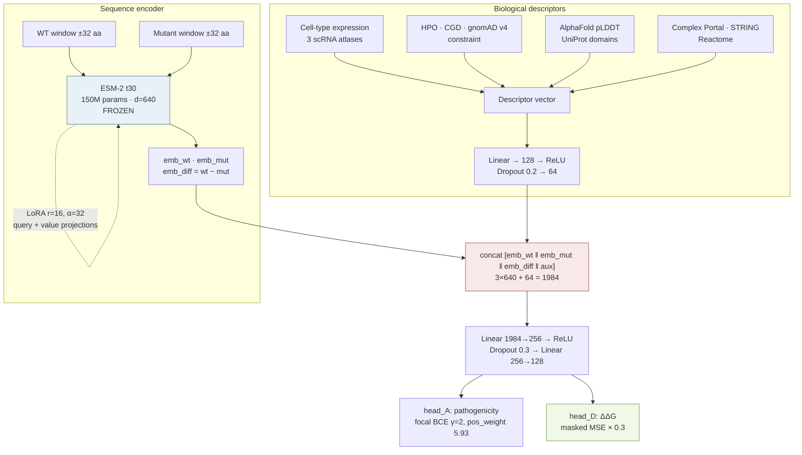
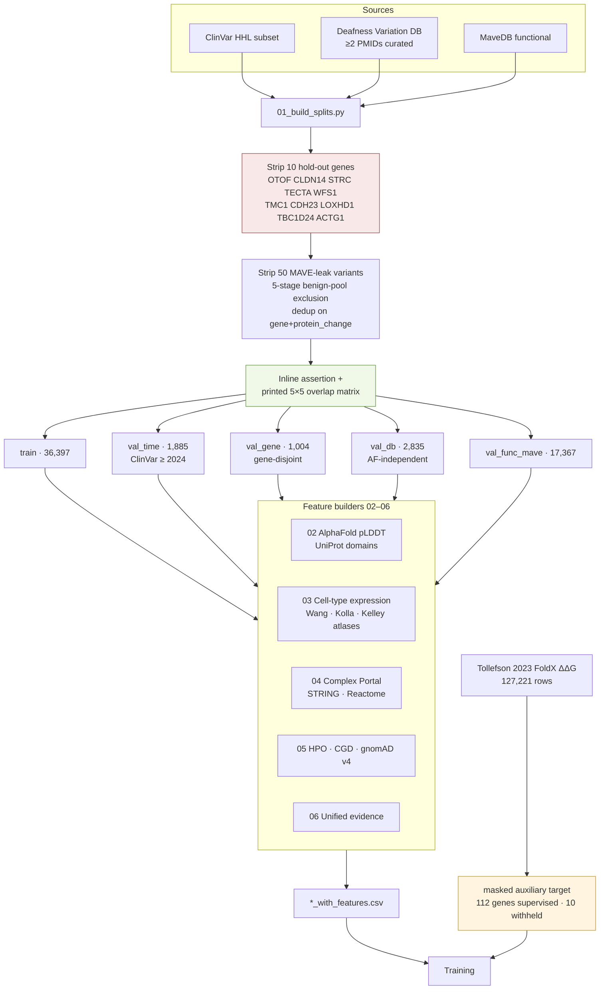
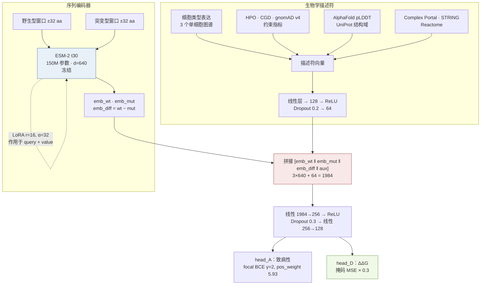
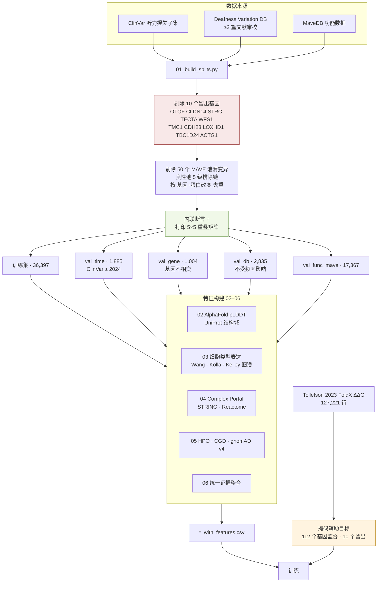

<div align="center">

# HEARS-LM

**Hereditary EAR Sequence Language Model**

*A hearing-loss–specific protein language model for missense variant pathogenicity, thermodynamics, and clinical interpretation*

[](#hears-lm)
[](#hears-lm-中文说明)

[](LICENSE)
[](https://www.python.org/downloads/)
[](https://pytorch.org/)
[](https://github.com/facebookresearch/esm)
[](https://doi.org/10.5281/zenodo.20311407)

</div>

---

## TL;DR

HEARS-LM adapts ESM-2 to inner-ear biology with LoRA, fuses the sequence representation with a curated panel of hearing-loss descriptors, and trains under an auxiliary thermodynamic objective supervised by FoldX folding free energies. The interesting result is not raw pathogenicity AUROC — it is **what the auxiliary objective transfers**.

| | |
|---|---|
| **Thermodynamic transfer** | Median Spearman **ρ = 0.826** [0.754, 0.851] on **10 genes never seen during ΔΔG supervision** — **+0.547** over ESM-2 zero-shot |
| **Per-residue landscapes** | Beats AlphaMissense on **12 of 26** genes, **0 significant losses** (paired bootstrap, p = 2.4 × 10⁻⁴) |
| **Precision@10** | **0.758** vs AlphaMissense 0.522 and ESM-2 zero-shot 0.425 (Wilcoxon p = 3.1 × 10⁻⁶) |
| **Prospective** | Anticipates ClinVar VUS→P upgrades **16 months ahead** — AUROC **0.748** vs METARNN 0.732, AlphaMissense 0.722 |
| **Expert agreement** | AUROC **0.901** vs ClinGen HL-VCEP labels; PP3/BP4 concordance at p < 10⁻⁶ both directions |
| **OTOF map** | 1,997 residues, 100 % coverage, residue AUROC **0.950** — relevant to DB-OTO gene therapy ([NCT05788536](https://clinicaltrials.gov/study/NCT05788536)) |
| **Compute** | Trained in **~4 hours on Apple Silicon (MPS)**. No GPU cluster. |

> **Where this model does *not* win.** On raw per-variant AUROC it ranks 6 of 8 on the allele-frequency-independent benchmark (0.840 vs METARNN 0.898). That is reported here deliberately — see [Honest limitations](#honest-limitations). Its advantages are transfer, coverage, and residue-level resolution, not leaderboard position.

## Why HEARS-LM?

| Capability | HEARS-LM | General-purpose predictors |
|---|---|---|
| Training data | Hearing-loss curated variants — 36,397 across 112 genes | Broad proteome |
| Coverage on hearing-loss genes | **100 % on every split** | AlphaMissense / REVEL / METARNN cover 57.5 % of `val_gene`; EVE 36.1 % |
| Thermodynamic ΔΔG head | Yes — ρ **0.826** on 10 genes withheld from ΔΔG supervision | No dedicated head |
| Expert-panel alignment (HL-VCEP PP3/BP4) | Yes — p < 10⁻⁶ in both directions | Not evaluated |
| Prospective reclassification | Yes — AUROC **0.748**, 16 months ahead | Not demonstrated |
| Per-residue tolerance landscapes | Better than AlphaMissense on **12/26** genes, **0** significant losses | Baseline |
| Gene-therapy target map | *OTOF*, 1,997 residues, AUROC **0.950** | Not available |
| Uses other predictors as input | **No** — stacking is blocked in code | Varies |
| Raw per-variant AUROC (AF-independent) | 0.840 — **rank 6/8** | METARNN 0.898 |

The last two rows belong together: HEARS-LM refuses to consume other tools' scores as features, which costs it leaderboard position and buys independence. Where it wins is where that independence pays off — unseen genes, unscored variants, and residue-level resolution.

---

## The problem

Hereditary hearing loss affects roughly 1 in 500 newborns, is caused by variants in more than 150 genes, and has left **37,043 missense VUS across 157 genes** in ClinVar — far more than expert panels can curate.

No leading predictor is adapted to inner-ear biology. Transmembrane K⁺ channels, unconventional myosins, large tectins and atypical adhesion molecules each concentrate their pathogenic variants in specific domains rather than spreading them uniformly, and general-purpose models have no way to know this.

There is also a measurement problem that this field under-acknowledges: **apparent performance on standard ClinVar splits is largely an allele-frequency artifact.** gnomAD popmax *alone* reaches AUROC 0.987 on a temporal split and 0.900 on a gene-disjoint split. A headline AUROC therefore mostly reflects population context, not learned protein biology. This repository's primary benchmark is consequently `val_db` — DVD-curated variants with **gnomAD popmax = 0**, where that shortcut is unavailable and every score drops sharply.

---

## Architecture

> Documented here as **implemented in the released code** (`src/model/train.py`). A four-head cross-attention variant was also trained during development; all results reported below come from the two-head `t30` model described here.



**The auxiliary objective is the point.** `head_D` regresses FoldX folding free energy (ΔΔG) from 127,221 precomputed values, under a **masked** MSE — variants without a ΔΔG label contribute exactly zero to that term. Total loss is `L_pathogenicity + 0.3 · L_ΔΔG`. Crucially, ΔΔG supervision covers 112 genes and **withholds 10 entirely**, which is what makes the transfer result below meaningful.

**Anti-stacking is enforced in code, not just promised.** All `baseline_*` and `am_*` columns, plus `esm_llr`, `revel` and `cadd_phred`, are dropped from the feature matrix before training (`train.py:210-215`). HEARS-LM never sees another predictor's output. This costs measurable AUROC and is the reason a stacked LightGBM baseline beats it — that trade is deliberate.

| Setting | Value |
|---|---|
| Backbone | `facebook/esm2_t30_150M_UR50D`, frozen |
| LoRA | r = 16, α = 32, dropout 0.1, on query + value |
| Window | ±32 aa around the variant (67 tokens) |
| Optimizer | AdamW, lr 5e-5, weight decay 0.01, cosine schedule |
| Schedule | 3 epochs, batch size 2 |
| Class imbalance | `pos_weight = 5.93`, focal γ = 2.0 |
| Hardware | Apple Silicon MPS (CPU fallback) |
| Runtime | ≈ 80 min/epoch, **≈ 4 h total** |

---

## Data pipeline



**Validation is deliberately four-dimensional**, because any single split can be gamed:

| Split | n | What it tests |
|---|---|---|
| `val_time` | 1,885 | Temporal — first curated in ClinVar ≥ 2024-01 |
| `val_gene` | 1,004 | Gene-disjoint — 10 genes withheld entirely |
| `val_db` | 2,835 | **AF-independent** — DVD-curated, gnomAD popmax = 0 |
| `val_func_mave` | 17,367 | Functional — MAVE/DMS across 13 genes |

Leakage control is a five-stage exclusion chain on the benign pool, plus an inline `assert`, plus a printed pairwise-overlap matrix that comes out all zeros. GJB2 is deliberately **not** held out — withholding the commonest hearing-loss gene would cripple the model for no scientific gain.

---

## Results

### Thermodynamic transfer to unseen genes — the headline

On **10 genes with programmatically verified zero overlap** with ΔΔG supervision (n = 500 variants):

| Comparison | Spearman ρ | Δ vs HEARS-LM | 95 % CI |
|---|---|---|---|
| **HEARS-LM** (per-gene median) | **0.826** | — | [0.754, 0.851] |
| REVEL | 0.374 | +0.423 | [+0.342, +0.726] |
| AlphaMissense | 0.294 | +0.454 | [+0.322, +0.792] |
| ESM-2 zero-shot | 0.279 | **+0.547** | [+0.360, +0.645] |
| phyloP-100 | 0.058 | +0.697 | [+0.504, +0.705] |

Across 27 genes with ≥ 20 variants, per-gene median ρ = 0.744 and **18 of 27 (67 %) exceed ρ = 0.7**. Predicted |ΔΔG| separates pathogenic from benign variants at Mann–Whitney p = 2.2 × 10⁻³⁵. The model learned protein biophysics that generalises to proteins it was never given energies for.

### Per-residue tolerance landscapes

Paired bootstrap across 26 genes:

| Comparison | Median AUC | Median Δ | 95 % CI | p | Wins | Losses |
|---|---|---|---|---|---|---|
| vs **AlphaMissense** | 0.879 vs 0.697 | **+0.151** | [+0.068, +0.216] | 2.4 × 10⁻⁴ | **12/26** | **0** |
| vs **ESM-2 zero-shot** | 0.879 vs 0.603 | **+0.274** | [+0.209, +0.384] | 2.4 × 10⁻⁷ | **22/26** | **0** |

Largest gains: OTOG +0.606 · SLC4A11 +0.584 · LOXHD1 +0.472 · USH1C +0.383 · ADGRV1 +0.369 · CDH23 +0.339 · OTOF +0.195 · USH2A +0.192. Gains concentrate in **syndromic** genes (7/13 significant wins, median Δ +0.192) and the **Usher cluster** averages Δ +0.315. Non-significant or negative: GJB2 −0.029, COL11A1 −0.036, SLC26A4 −0.107.

**Precision at K**, across 36 genes:

| K | HEARS-LM | AlphaMissense | ESM-2 zs | vs AM | vs ESM |
|---|---|---|---|---|---|
| P@5 | **0.828** | 0.522 | 0.444 | 8.5 × 10⁻⁵ | 4.4 × 10⁻⁵ |
| **P@10** | **0.758** | 0.522 | 0.425 | **3.1 × 10⁻⁶** | **6.3 × 10⁻⁶** |
| P@20 | **0.664** | 0.500 | 0.399 | 5.0 × 10⁻⁶ | 2.3 × 10⁻⁶ |

**13 of 36 genes reach a perfect P@10 = 1.00**, versus 2 of 36 for both AlphaMissense and ESM-2 zero-shot. On a 10-method leaderboard HEARS-LM ranks first (P@10 0.669), ahead of MutPred 0.494, DeOgen-2 0.421 and METARNN 0.417.

### The model learned real inner-ear biology

Transmembrane-domain enrichment (hypergeometric): KCNQ1 47 % vs 20 % baseline, OR 6.67, **p = 2.4 × 10⁻⁷**; KCNQ4 50 % vs 20 %, p = 4.9 × 10⁻⁶; GJB2 55 % vs 37 %, p = 4.5 × 10⁻⁴.

3D clustering on AlphaFold structures (10,000 permutations): KCNQ4 34.5 Å vs 62.0 Å random, **p < 0.0001**; KCNQ1 40.7 Å vs 54.8 Å, p < 0.0001. Notably OTOF, USH2A, CDH23 and CHD7 show **no** significant clustering — the model is not indiscriminately clustering everything.

### Agreement with expert curation

Against ClinGen HL-VCEP labels on 66 held-out variants: **AUROC 0.901** (val_gene 0.971, val_time 0.912, val_db 0.648).

| ACMG code | Applied | Not applied | Mann–Whitney p |
|---|---|---|---|
| **PP3** | mean pred 0.747 (n=78) | 0.497 (n=89) | 1.2 × 10⁻⁶ |
| **BP4** | mean pred 0.209 (n=13) | 0.648 (n=154) | 8.4 × 10⁻⁷ |

On KCNQ4 the model recovers **5 of 6** expert rule positions among 695 candidates — OR 88.2, hypergeometric p = 4.7 × 10⁻⁶.

### Prospective reclassification

Tracking four ClinVar snapshots from 2025-01 to 2026-04, on the identical task:

| Method | AUROC (upgrades vs stable VUS) |
|---|---|
| **HEARS-LM** | **0.748** |
| METARNN | 0.732 |
| AlphaMissense | 0.722 |
| ESM-2 zero-shot | 0.701 |
| REVEL | 0.608 |

Variants later upgraded VUS→P scored 0.669 on average versus 0.376 for stable VUS (p = 7.4 × 10⁻⁷). Correct calls made ~16 months early include USH2A Trp3130Arg (0.99), ATP2B2 Thr503Met (0.90), MYO7A Glu442Lys (0.86, Usher 1B) and KCNQ4 Trp224Arg (0.79, DFNA2).

### OTOF landscape and gene therapy

A complete **1,997-residue** map at 100 % position coverage, residue-level **AUROC 0.950** versus AlphaMissense 0.752 and ESM-2 zero-shot 0.626. 108 ClinVar P/LP residues confirmed, with the highest scores concentrated in the C2D and C2E domains, plus **16 additional high-confidence VUS** in functional C2 domains flagged for review. This matters clinically: the DB-OTO AAV gene-therapy trial ([NCT05788536](https://clinicaltrials.gov/study/NCT05788536)) requires confident biallelic pathogenic classification for enrolment.

### VUS catalogue

**227 high-confidence reclassifications** (predicted > 0.7) across 12 syndromic genes — WFS1 59, USH2A 50, CDH23 43, LOXHD1 22, OTOF 16, TECTA 14. Novelty audit: 181 (80 %) sit at a known pathogenic position, 26 (11 %) are truly novel, 20 (9 %) are more than 5 aa from any known pathogenic residue.

The threshold was chosen for statistical honesty rather than for the prettier number: predicted > 0.9 gives 100 % PPV on n = 36 but is **not** significant against an always-pathogenic baseline (binomial p = 0.148). **Predicted > 0.8 (n = 110, 99.1 % PPV, p = 0.020) is the lowest defensible threshold**, so that is the one reported.

### Honest limitations

This project keeps an adversarial self-audit log; these are stated in the paper, not buried.

| Limitation | Detail |
|---|---|
| **Not best on per-variant AUROC** | val_db 0.840, rank 6/8 (METARNN 0.898). A stacked LightGBM over 28 predictors reaches 0.895 — HEARS-LM refuses to stack, and 0.840 is close to the realistic PLM-only ceiling |
| **AlphaMissense wins the external test** | DVD-NEW, 4,368 unseen variants: AlphaMissense 0.967 at 64 % coverage vs HEARS-LM 0.789 at 100 % coverage |
| **MAVE/DMS is a null result** | ρ ≈ −0.002 (n = 17,367). Every method does poorly here (AlphaMissense best at −0.327); not surfaced in any headline table |
| **Mechanism head does not generalise** | val_db LoF AUC 0.506 — chance. 89 % of mechanism labels are LoF and gene-level |
| **Calibration is weak** | val_db Brier 0.237, ECE 0.290 — worst of 7 tools. Platt or isotonic scaling is required before deployment |
| **A headline was retracted** | An earlier KCNQ4 result was withdrawn after discovering author selection bias in hand-curated residue lists, then re-run against objective ClinVar P/LP residues |

Where HEARS-LM does win unambiguously is **coverage**: it and ESM-2 zero-shot are the only methods scoring 100 % of variants on every split, while METARNN, REVEL and AlphaMissense cover just 57.5 % of `val_gene` and EVE only 36.1 %. On coverage-adjusted utility it ranks **1 of 8**.

---

## Repository layout

```
hears-lm/
├── src/
│   ├── data/         01 splits (gene-holdout + leakage audit) · 02 structure/domain
│   │                 03 cell-type · 04 complex/PPI · 05 HPO+CGD+gnomAD · 06 unified evidence
│   ├── model/        train.py (ESM-2 + LoRA + fusion + 2 heads) · inference.py · predict_splits.py
│   ├── evaluation/   benchmark.py · esm2_zeroshot.py · acmg_mapper.py · hl_vcep_validation.py
│   └── figures/      Publication figure generation
├── requirements.txt
├── CITATION.cff
└── LICENSE           MIT
```

Source code only. Trained checkpoints, processed features, prediction CSVs, rendered figures and the manuscript are **not** included — they are deposited at Zenodo ([10.5281/zenodo.20311407](https://doi.org/10.5281/zenodo.20311407)).

## Installation

```bash
git clone https://github.com/pipi0616/hears-lm.git
cd hears-lm
python -m venv .venv && source .venv/bin/activate
pip install -r requirements.txt
```

Python 3.10+. A GPU is helpful but not required — the released model was trained end to end on Apple Silicon. For Apple Silicon install the MPS-compatible PyTorch build.

## Usage

```bash
# Build splits and features (requires the raw source corpora — see Data availability)
python src/data/01_build_splits.py
python src/data/02_build_pervariant_features.py
python src/data/03_build_celltype_features.py
python src/data/04_build_complex_features.py
python src/data/05_build_hhl_clinical_features.py
python src/data/06_build_external_evidence.py

# Train — hyperparameters are set in the CONFIG dict at the top of train.py
python src/model/train.py

# Score held-out splits with a trained checkpoint
python src/model/inference.py

# ESM-2 zero-shot baseline
python src/evaluation/esm2_zeroshot.py

# Multi-tool benchmark and ACMG / HL-VCEP validation
python src/evaluation/benchmark.py
python src/evaluation/hl_vcep_validation.py
```

> **Note on paths.** The scripts currently resolve data locations against the author's working tree. Before running on your own machine, set the input and output directories at the top of each script. Making these configurable is the next planned change.

## Data availability

| Artifact | Where |
|---|---|
| Code | This repository (MIT) |
| Checkpoints, features, predictions, figures | Zenodo [10.5281/zenodo.20311407](https://doi.org/10.5281/zenodo.20311407) |
| ClinVar, gnomAD v4, AlphaFold, UniProt, HPO, CGD | Primary sources, all open access |
| Deafness Variation Database v9 | [deafnessvariationdatabase.org](https://deafnessvariationdatabase.org/) |
| FoldX ΔΔG | Tollefson et al. 2024 supplementary data |

## Citation

```bibtex
@article{ye2026hearslm,
  title   = {HEARS-LM: a hearing-loss-specialized protein language model
             integrating molecular biophysics for clinical variant interpretation},
  author  = {Ye, Shaopei and Chen, Peng},
  year    = {2026},
  note    = {Manuscript under review}
}

@software{ye2026hearslm_software,
  title     = {HEARS-LM: Hereditary EAR Sequence Language Model},
  author    = {Ye, Shaopei and Chen, Peng},
  year      = {2026},
  url       = {https://github.com/pipi0616/hears-lm},
  doi       = {10.5281/zenodo.20311407},
  publisher = {Zenodo}
}
```

## Authors

**Shaopei Ye** — Universitat de Barcelona, Spain · [ORCID 0009-0006-3598-0469](https://orcid.org/0009-0006-3598-0469) · shaopeiye55@gmail.com
**Peng Chen** — Dept. of Otorhinolaryngology, Meishan People's Hospital, China · [ORCID 0009-0001-1105-6638](https://orcid.org/0009-0001-1105-6638)

## Acknowledgements

ESM-2 (Lin et al. 2023) · AlphaFold2 (Jumper et al. 2021) · FoldX (Schymkowitz et al. 2005) · ClinVar (Landrum et al. 2020) · Deafness Variation Database (Azaiez et al. 2018) · ClinGen Hearing Loss Variant Curation Expert Panel.

## License

MIT — see [LICENSE](LICENSE).

**This is a research tool, not a clinical decision-support device.** Reclassification submissions to ClinGen HL-VCEP should follow the panel's standard process.

## Related work

- [**OtoVCE**](https://github.com/pipi0616/OtoVCE) — LLM evidence layer for hearing-loss variant interpretation
- [**SeizeVar**](https://github.com/pipi0616/seizevar) — mechanism-aware epilepsy variant interpretation
- [**QAFI**](https://github.com/pipi0616/QAFI) — quantitative functional-impact prediction

<br/>

---

<div align="center">

## 🌏 中文版本 / Chinese Version

**点击下方展开完整中文文档 · Click below to expand the full Chinese documentation**

</div>

<details>
<summary><h3>👉 HEARS-LM 中文说明（点击展开 / Click to expand）</h3></summary>

<br/>

<div align="center">

# HEARS-LM 中文说明

**遗传性耳聋序列语言模型（Hereditary EAR Sequence Language Model）**

*面向错义变异致病性、热力学与临床解读的听力损失专用蛋白质语言模型*

[](#hears-lm)
[](#hears-lm-中文说明)

</div>

---

## 一句话概括

HEARS-LM 用 LoRA 将 ESM-2 适配到内耳生物学，把序列表示与一组精选的听力损失描述符融合，并在以 FoldX 折叠自由能为监督的辅助热力学目标下训练。真正有价值的结果不是原始致病性 AUROC，而是**这个辅助目标迁移出了什么**。

| | |
|---|---|
| **热力学迁移** | 在**从未参与 ΔΔG 监督的 10 个基因**上，Spearman 中位数 **ρ = 0.826** [0.754, 0.851]——比 ESM-2 零样本高 **+0.547** |
| **逐残基耐受图谱** | 在 **26 个基因中的 12 个**上优于 AlphaMissense，**显著劣势为 0**（配对自助法，p = 2.4 × 10⁻⁴） |
| **前 10 精确度** | **0.758**，AlphaMissense 为 0.522，ESM-2 零样本为 0.425（Wilcoxon p = 3.1 × 10⁻⁶） |
| **前瞻性验证** | 比专家**提前 16 个月**预判 ClinVar VUS→致病的升级——AUROC **0.748**，METARNN 0.732，AlphaMissense 0.722 |
| **专家一致性** | 对 ClinGen HL-VCEP 标签 AUROC **0.901**；PP3/BP4 双向一致性 p < 10⁻⁶ |
| **OTOF 图谱** | 1,997 个残基，100% 覆盖，残基级 AUROC **0.950**——与 DB-OTO 基因治疗试验（[NCT05788536](https://clinicaltrials.gov/study/NCT05788536)）直接相关 |
| **算力** | 在 **Apple Silicon（MPS）上约 4 小时**完成训练，未使用任何 GPU 集群 |

> **本模型不占优的地方。** 在原始逐变异 AUROC 上，它在不受等位基因频率影响的基准集上排名 8 个工具中的第 6（0.840 vs METARNN 0.898）。这一点在此**刻意如实报告**——详见[诚实的局限性](#诚实的局限性)。它的优势在于迁移能力、覆盖率和残基级分辨率，而非排行榜名次。

## 为什么需要 HEARS-LM？

| 能力 | HEARS-LM | 通用预测器 |
|---|---|---|
| 训练数据 | 听力损失专门审校变异——112 个基因、36,397 个变异 | 泛蛋白质组 |
| 听力损失基因覆盖率 | **所有划分上均为 100%** | AlphaMissense / REVEL / METARNN 在 `val_gene` 上仅 57.5%；EVE 36.1% |
| 热力学 ΔΔG 输出头 | 有——在 10 个未参与 ΔΔG 监督的基因上 ρ **0.826** | 无专门输出头 |
| 与专家组一致性（HL-VCEP PP3/BP4） | 有——双向 p < 10⁻⁶ | 未评估 |
| 前瞻性重分类 | 有——AUROC **0.748**，提前 16 个月 | 未验证 |
| 逐残基耐受图谱 | 在 **26 个基因中的 12 个**上优于 AlphaMissense，**0** 项显著劣势 | 基线 |
| 基因治疗靶点图谱 | *OTOF*，1,997 个残基，AUROC **0.950** | 无 |
| 是否使用其他预测器作为输入 | **否**——代码层面禁止堆叠 | 视具体工具而定 |
| 原始逐变异 AUROC（不受频率影响） | 0.840——**排名 6/8** | METARNN 0.898 |

最后两行应当放在一起看：HEARS-LM 拒绝把其他工具的分数作为特征，这让它在排行榜上吃亏，换来的是独立性。而它真正取胜的场景，恰恰是这种独立性能兑现价值的地方——未见过的基因、其他工具打不出分的变异，以及残基级分辨率。

---

## 研究问题

遗传性听力损失约影响每 500 名新生儿中的 1 名，致病基因超过 150 个，在 ClinVar 中已积累 **157 个基因、37,043 个错义 VUS**——远超专家小组的审校能力。

现有主流预测器没有一个是针对内耳生物学适配的。跨膜钾通道、非常规肌球蛋白、大型盖膜蛋白和非典型黏附分子，各自把致病变异集中在特定结构域而非均匀分布，而通用模型无从知晓这一点。

此外还有一个该领域讨论不足的测量问题：**标准 ClinVar 划分上的表面性能，很大程度上是等位基因频率造成的假象。** 仅用 gnomAD popmax 一项，在时间划分上就能达到 AUROC 0.987，在基因不相交划分上达到 0.900。因此一个漂亮的 AUROC 主要反映的是人群频率背景，而非学到的蛋白质生物学。基于此，本仓库的主要基准集是 `val_db`——经 DVD 审校且 **gnomAD popmax = 0** 的变异，在这里上述捷径不复存在，所有工具的分数都会明显下降。

---

## 模型架构

> 此处描述的是**已发布代码中的实际实现**（`src/model/train.py`）。开发过程中还训练过一个四输出头的交叉注意力变体；下文报告的全部结果均来自此处描述的双头 `t30` 模型。



**辅助目标才是关键。** `head_D` 基于 127,221 个预计算值回归 FoldX 折叠自由能（ΔΔG），使用**掩码** MSE——没有 ΔΔG 标签的变异对该项贡献恰好为零。总损失为 `L_致病性 + 0.3 · L_ΔΔG`。至关重要的是，ΔΔG 监督覆盖 112 个基因，并**完整留出 10 个基因**，这正是下文迁移结果有意义的前提。

**"不做模型堆叠"是在代码中强制执行的，而非口头承诺。** 训练前所有 `baseline_*`、`am_*` 列，以及 `esm_llr`、`revel`、`cadd_phred` 都会从特征矩阵中剔除（`train.py:210-215`）。HEARS-LM 从不接触任何其他预测器的输出。这确实牺牲了可观的 AUROC，也正是堆叠式 LightGBM 基线能胜过它的原因——这是有意的取舍。

| 配置项 | 取值 |
|---|---|
| 骨干网络 | `facebook/esm2_t30_150M_UR50D`，冻结 |
| LoRA | r = 16，α = 32，dropout 0.1，作用于 query + value |
| 窗口 | 变异位点前后各 32 个氨基酸（67 个 token） |
| 优化器 | AdamW，学习率 5e-5，权重衰减 0.01，余弦调度 |
| 训练计划 | 3 个 epoch，batch size 2 |
| 类别不平衡 | `pos_weight = 5.93`，focal γ = 2.0 |
| 硬件 | Apple Silicon MPS（可回退 CPU） |
| 耗时 | 每 epoch 约 80 分钟，**总计约 4 小时** |

---

## 数据流程



**验证刻意设计为四个维度**，因为任何单一划分都可能被"钻空子"：

| 划分 | n | 检验什么 |
|---|---|---|
| `val_time` | 1,885 | 时间——ClinVar 首次审校时间 ≥ 2024-01 |
| `val_gene` | 1,004 | 基因不相交——10 个基因完整留出 |
| `val_db` | 2,835 | **不受频率影响**——DVD 审校且 gnomAD popmax = 0 |
| `val_func_mave` | 17,367 | 功能学——覆盖 13 个基因的 MAVE/DMS |

泄漏管控包括对良性池的五级排除链、一条内联 `assert`，以及一个打印出来、结果全为零的两两重叠矩阵。GJB2 **有意不做留出**——把最常见的听力损失基因留出只会削弱模型，换不来任何科学收益。

---

## 结果

### 向未见基因的热力学迁移——核心结果

在 **10 个经程序验证与 ΔΔG 监督零重叠的基因**上（n = 500 个变异）：

| 对比对象 | Spearman ρ | 相对 HEARS-LM 的差值 | 95% CI |
|---|---|---|---|
| **HEARS-LM**（逐基因中位数） | **0.826** | — | [0.754, 0.851] |
| REVEL | 0.374 | +0.423 | [+0.342, +0.726] |
| AlphaMissense | 0.294 | +0.454 | [+0.322, +0.792] |
| ESM-2 零样本 | 0.279 | **+0.547** | [+0.360, +0.645] |
| phyloP-100 | 0.058 | +0.697 | [+0.504, +0.705] |

在 27 个变异数 ≥ 20 的基因上，逐基因中位数 ρ = 0.744，且 **27 个中有 18 个（67%）超过 ρ = 0.7**。预测的 |ΔΔG| 区分致病与良性变异，Mann–Whitney p = 2.2 × 10⁻³⁵。模型学到了可以泛化到"从未提供过能量标签"的蛋白质上的生物物理规律。

### 逐残基耐受图谱

跨 26 个基因的配对自助法：

| 对比 | AUC 中位数 | 差值中位数 | 95% CI | p | 显著优势 | 显著劣势 |
|---|---|---|---|---|---|---|
| vs **AlphaMissense** | 0.879 vs 0.697 | **+0.151** | [+0.068, +0.216] | 2.4 × 10⁻⁴ | **12/26** | **0** |
| vs **ESM-2 零样本** | 0.879 vs 0.603 | **+0.274** | [+0.209, +0.384] | 2.4 × 10⁻⁷ | **22/26** | **0** |

增益最大的基因：OTOG +0.606 · SLC4A11 +0.584 · LOXHD1 +0.472 · USH1C +0.383 · ADGRV1 +0.369 · CDH23 +0.339 · OTOF +0.195 · USH2A +0.192。增益集中在**综合征型**基因（13 个中 7 个显著优势，差值中位数 +0.192），**Usher 综合征基因簇**平均差值达 +0.315。不显著或为负：GJB2 −0.029、COL11A1 −0.036、SLC26A4 −0.107。

**前 K 精确度**，覆盖 36 个基因：

| K | HEARS-LM | AlphaMissense | ESM-2 零样本 | vs AM | vs ESM |
|---|---|---|---|---|---|
| P@5 | **0.828** | 0.522 | 0.444 | 8.5 × 10⁻⁵ | 4.4 × 10⁻⁵ |
| **P@10** | **0.758** | 0.522 | 0.425 | **3.1 × 10⁻⁶** | **6.3 × 10⁻⁶** |
| P@20 | **0.664** | 0.500 | 0.399 | 5.0 × 10⁻⁶ | 2.3 × 10⁻⁶ |

**36 个基因中有 13 个达到完美的 P@10 = 1.00**，而 AlphaMissense 和 ESM-2 零样本各只有 2 个。在 10 种方法的排行榜上 HEARS-LM 位列第一（P@10 0.669），领先 MutPred 0.494、DeOgen-2 0.421 和 METARNN 0.417。

### 模型确实学到了真实的内耳生物学

跨膜结构域富集（超几何检验）：KCNQ1 47% vs 基线 20%，OR 6.67，**p = 2.4 × 10⁻⁷**；KCNQ4 50% vs 20%，p = 4.9 × 10⁻⁶；GJB2 55% vs 37%，p = 4.5 × 10⁻⁴。

在 AlphaFold 结构上的三维聚集性检验（10,000 次置换）：KCNQ4 34.5 Å vs 随机 62.0 Å，**p < 0.0001**；KCNQ1 40.7 Å vs 54.8 Å，p < 0.0001。值得注意的是 OTOF、USH2A、CDH23 和 CHD7 **未**显示显著聚集——说明模型并非不加区分地把所有东西都聚成一团。

### 与专家审校的一致性

在 66 个留出变异上对照 ClinGen HL-VCEP 标签：**AUROC 0.901**（val_gene 0.971，val_time 0.912，val_db 0.648）。

| ACMG 判据 | 已应用 | 未应用 | Mann–Whitney p |
|---|---|---|---|
| **PP3** | 平均预测值 0.747（n=78） | 0.497（n=89） | 1.2 × 10⁻⁶ |
| **BP4** | 平均预测值 0.209（n=13） | 0.648（n=154） | 8.4 × 10⁻⁷ |

在 KCNQ4 上，模型从 695 个候选位点中找回了专家规则位点中的 **5 个（共 6 个）**——OR 88.2，超几何检验 p = 4.7 × 10⁻⁶。

### 前瞻性重分类

追踪 2025-01 至 2026-04 的四个 ClinVar 快照，在完全相同的任务上：

| 方法 | AUROC（升级 vs 稳定 VUS） |
|---|---|
| **HEARS-LM** | **0.748** |
| METARNN | 0.732 |
| AlphaMissense | 0.722 |
| ESM-2 零样本 | 0.701 |
| REVEL | 0.608 |

后来被升级为致病的变异平均得分 0.669，而保持 VUS 的为 0.376（p = 7.4 × 10⁻⁷）。提前约 16 个月做出的正确判定包括 USH2A Trp3130Arg（0.99）、ATP2B2 Thr503Met（0.90）、MYO7A Glu442Lys（0.86，Usher 1B 型）和 KCNQ4 Trp224Arg（0.79，DFNA2）。

### OTOF 图谱与基因治疗

一份完整的 **1,997 残基**图谱，位点覆盖率 100%，残基级 **AUROC 0.950**，而 AlphaMissense 为 0.752、ESM-2 零样本为 0.626。确认了 108 个 ClinVar 致病残基，最高分集中在 C2D 和 C2E 结构域，另标记出功能性 C2 结构域内 **16 个高置信度 VUS** 供复核。这具有直接临床意义：DB-OTO AAV 基因治疗试验（[NCT05788536](https://clinicaltrials.gov/study/NCT05788536)）的入组要求明确的双等位基因致病判定。

### VUS 目录

在 12 个综合征型基因中给出 **227 个高置信度重分类**（预测值 > 0.7）——WFS1 59 个、USH2A 50 个、CDH23 43 个、LOXHD1 22 个、OTOF 16 个、TECTA 14 个。新颖性审计：181 个（80%）位于已知致病位点，26 个（11%）确属全新，20 个（9%）距任何已知致病残基超过 5 个氨基酸。

阈值的选择服从统计诚实而非更好看的数字：预测值 > 0.9 时在 n = 36 上可得 100% 阳性预测值，但相对"全判致病"基线**并不显著**（二项检验 p = 0.148）。**预测值 > 0.8（n = 110，PPV 99.1%，p = 0.020）才是最低的可辩护阈值**，因此报告的是后者。

### 诚实的局限性

本项目维护一份对抗性自查日志；以下内容写在论文里，而非被掩盖。

| 局限 | 细节 |
|---|---|
| **逐变异 AUROC 并非最佳** | val_db 上 0.840，8 个工具中排第 6（METARNN 0.898）。堆叠 28 个预测器的 LightGBM 可达 0.895——HEARS-LM 拒绝堆叠，而 0.840 已接近纯语言模型路线的现实上限 |
| **外部测试中 AlphaMissense 更强** | DVD-NEW 的 4,368 个未见变异：AlphaMissense 0.967（覆盖率 64%）vs HEARS-LM 0.789（覆盖率 100%） |
| **MAVE/DMS 是阴性结果** | ρ ≈ −0.002（n = 17,367）。所有方法在此都表现不佳（AlphaMissense 最好，为 −0.327）；未纳入任何主表 |
| **机制头无法泛化** | val_db 上功能缺失 AUC 0.506——等于随机。89% 的机制标签是功能缺失且为基因级标注 |
| **校准度较差** | val_db Brier 0.237，ECE 0.290——7 个工具中最差。部署前需要 Platt 或等渗校准 |
| **曾撤回一项主结果** | 早期一项 KCNQ4 结果因发现手工整理残基列表存在作者选择偏倚而撤回，并改用客观的 ClinVar 致病残基重新计算 |

HEARS-LM 明确占优的地方是**覆盖率**：它与 ESM-2 零样本是仅有的在所有划分上都能为 100% 变异打分的方法，而 METARNN、REVEL 和 AlphaMissense 在 `val_gene` 上只覆盖 57.5%，EVE 仅 36.1%。按覆盖率校正后的实用性排名，它位列 **8 个工具中的第 1**。

---

## 仓库结构

```
hears-lm/
├── src/
│   ├── data/         01 数据划分（基因留出 + 泄漏审计）· 02 结构/结构域
│   │                 03 细胞类型 · 04 复合物/蛋白互作 · 05 HPO+CGD+gnomAD · 06 统一证据
│   ├── model/        train.py（ESM-2 + LoRA + 融合 + 双头）· inference.py · predict_splits.py
│   ├── evaluation/   benchmark.py · esm2_zeroshot.py · acmg_mapper.py · hl_vcep_validation.py
│   └── figures/      论文图表生成
├── requirements.txt
├── CITATION.cff
└── LICENSE           MIT
```

仅包含源代码。训练好的检查点、处理后的特征、预测 CSV、渲染好的图表以及论文本身**均不包含**在内——它们存放于 Zenodo（[10.5281/zenodo.20311407](https://doi.org/10.5281/zenodo.20311407)）。

## 安装

```bash
git clone https://github.com/pipi0616/hears-lm.git
cd hears-lm
python -m venv .venv && source .venv/bin/activate
pip install -r requirements.txt
```

需要 Python 3.10+。有 GPU 会更快但并非必需——发布的模型完全在 Apple Silicon 上训练完成。Apple Silicon 用户请安装支持 MPS 的 PyTorch 构建版本。

## 使用方法

```bash
# 构建数据划分与特征（需要原始语料，见"数据获取"）
python src/data/01_build_splits.py
python src/data/02_build_pervariant_features.py
python src/data/03_build_celltype_features.py
python src/data/04_build_complex_features.py
python src/data/05_build_hhl_clinical_features.py
python src/data/06_build_external_evidence.py

# 训练——超参数在 train.py 顶部的 CONFIG 字典中设置
python src/model/train.py

# 用训练好的检查点为留出集打分
python src/model/inference.py

# ESM-2 零样本基线
python src/evaluation/esm2_zeroshot.py

# 多工具基准测试与 ACMG / HL-VCEP 验证
python src/evaluation/benchmark.py
python src/evaluation/hl_vcep_validation.py
```

> **关于路径的说明。** 当前脚本中的数据路径是基于作者本地工作目录解析的。在自己的机器上运行前，请先修改各脚本顶部的输入与输出目录。将这些路径改为可配置项是下一步的计划改动。

## 数据获取

| 内容 | 位置 |
|---|---|
| 代码 | 本仓库（MIT） |
| 检查点、特征、预测结果、图表 | Zenodo [10.5281/zenodo.20311407](https://doi.org/10.5281/zenodo.20311407) |
| ClinVar、gnomAD v4、AlphaFold、UniProt、HPO、CGD | 各自官方来源，均为开放获取 |
| Deafness Variation Database v9 | [deafnessvariationdatabase.org](https://deafnessvariationdatabase.org/) |
| FoldX ΔΔG | Tollefson 等 2024 补充数据 |

## 引用

```bibtex
@article{ye2026hearslm,
  title   = {HEARS-LM: a hearing-loss-specialized protein language model
             integrating molecular biophysics for clinical variant interpretation},
  author  = {Ye, Shaopei and Chen, Peng},
  year    = {2026},
  note    = {Manuscript under review}
}

@software{ye2026hearslm_software,
  title     = {HEARS-LM: Hereditary EAR Sequence Language Model},
  author    = {Ye, Shaopei and Chen, Peng},
  year      = {2026},
  url       = {https://github.com/pipi0616/hears-lm},
  doi       = {10.5281/zenodo.20311407},
  publisher = {Zenodo}
}
```

## 作者

**叶少培（Shaopei Ye）** — 巴塞罗那大学，西班牙 · [ORCID 0009-0006-3598-0469](https://orcid.org/0009-0006-3598-0469) · shaopeiye55@gmail.com
**陈鹏（Peng Chen）** — 眉山市人民医院耳鼻咽喉科 · [ORCID 0009-0001-1105-6638](https://orcid.org/0009-0001-1105-6638)

## 致谢

ESM-2（Lin 等 2023）· AlphaFold2（Jumper 等 2021）· FoldX（Schymkowitz 等 2005）· ClinVar（Landrum 等 2020）· Deafness Variation Database（Azaiez 等 2018）· ClinGen 听力损失变异审校专家组。

## 许可证

MIT——详见 [LICENSE](LICENSE)。

**本项目是研究工具，不是临床决策支持设备。** 向 ClinGen HL-VCEP 提交重分类建议应遵循该专家组的标准流程。

## 相关项目

- [**OtoVCE**](https://github.com/pipi0616/OtoVCE) — 听力损失变异解读的大模型证据抽取层
- [**SeizeVar**](https://github.com/pipi0616/seizevar) — 机制感知型癫痫变异解读框架
- [**QAFI**](https://github.com/pipi0616/QAFI) — 变异功能影响的定量预测

</details>
